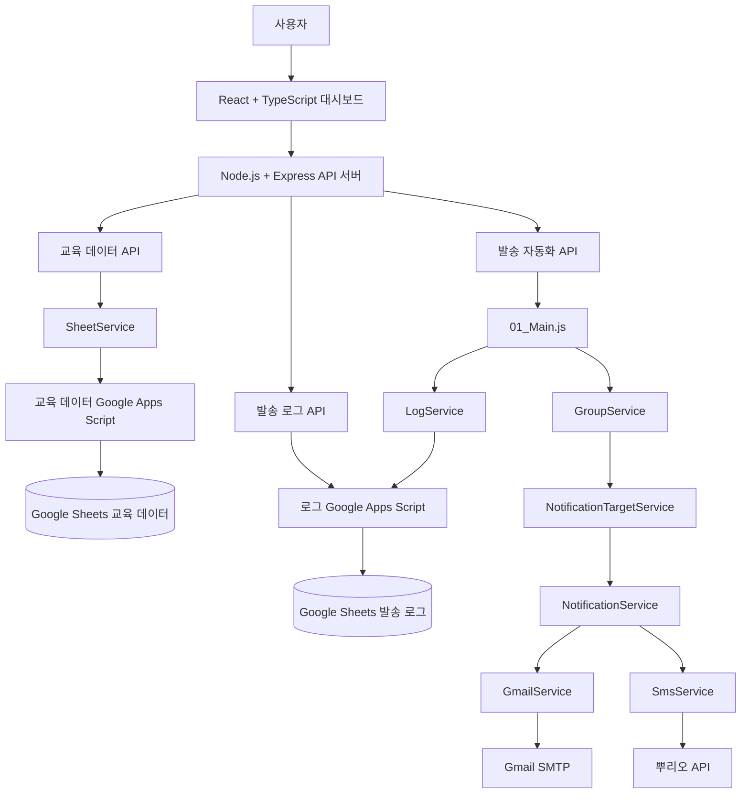

# 교육사업 운영 관리 및 문자&이메일 발송 자동화 시스템

교육사업 운영 과정에서 반복적으로 발생하는 데이터 확인 및 안내 업무를 효율화하기 위해 개발한 웹 기반 업무 자동화 시스템.

Google Sheets에 관리되는 교육 운영 데이터를 웹 대시보드에서 조회하고, 사업별 운영 현황을 확인하며, 교육 일정과 대상자 정보를 바탕으로 이메일 및 SMS 안내를 실행할 수 있도록 구성함.

발송 이후에는 결과를 Google Sheets에 기록하고 웹 화면에서 이력을 조회할 수 있음.

---

## 목차
- [1. 프로젝트 소개](#1-프로젝트-소개)
- [2. 개발 배경 및 목표](#2-개발-배경-및-목표)
- [3. 주요 기능](#3-주요-기능)
- [4. 시스템 아키텍처](#4-시스템-아키텍처)
- [5. 기술 스택](#5-기술-스택)
- [6. 주요 구현 내용](#6-주요-구현-내용)
- [7. 프로젝트 폴더 구조](#7-프로젝트-폴더-구조)
- [8. API 명세](#8-api-명세)
- [9. 설치 및 실행 방법](#9-설치-및-실행-방법)
- [10. 환경변수 및 외부 서비스 설정](#10-환경변수-및-외부-서비스-설정)
- [11. 보안 및 운영 시 유의사항](#11-보안-및-운영-시-유의사항)
- [12. 현재 구현 범위 및 향후 개선 계획](#12-현재-구현-범위-및-향후-개선-계획)

---

## 1. 프로젝트 소개

본 프로젝트는 교육사업 운영에 필요한 데이터 조회, 사업 현황 확인, 이메일·문자 발송, 발송 이력 관리를 하나의 웹 대시보드에서 처리하기 위해 개발함.

기존 Google Sheets 중심의 업무 흐름을 유지하면서 Node.js 기반 자동화 프로그램과 React 기반 웹 화면을 연결함. 

이를 통해 별도 스크립트를 직접 실행하지 않고도 웹 화면에서 교육 데이터를 확인하고 발송 작업을 실행할 수 있도록 확장함.

### 프로젝트 개요

| 항목 | 내용 |
|---|---|
| 프로젝트명 | 교육사업 운영 관리 및 문자&이메일 발송 자동화 시스템 |
| 프로젝트 유형 | 웹 기반 업무 관리 및 자동화 시스템 |
| 대상 사업 | GW, DS |
| 주요 목적 | 교육 운영 데이터 통합 조회 및 이메일·SMS 안내 업무 자동화 |
| 데이터 관리 | Google Sheets |
| 주요 구성 | React 프론트엔드, Express API 서버, Node.js 자동화 모듈, Google Apps Script |

[목차로 가기](#목차)

---
## 2. 개발 배경 및 목표

교육사업 운영 과정에서는 교육 일정과 수요처 정보 확인, 강사 및 담당교사 안내, 이메일·문자 발송, 발송 결과 확인 등 반복적인 행정 업무가 지속적으로 발생.

기존에는 Google Sheets에서 필요한 정보를 확인한 뒤 수신 대상자를 구분하고, 이메일과 문자를 발송한 다음 결과를 별도로 관리해야 했음.

또한 GW와 DS 사업은 데이터 컬럼과 교육 일정 구조, 알림 대상이 서로 달라 사업별 처리 기준을 구분할 필요가 있음.

이러한 업무 흐름을 개선하기 위해 다음을 목표로 시스템을 개발함.

- 여러 Google Sheets에 분산된 교육 운영 정보를 웹에서 통합 조회.
- GW와 DS의 서로 다른 데이터 구조를 사업별 기준에 맞게 처리.
- 교육 일정과 수신 대상 정보를 기반으로 이메일 및 SMS 발송 자동화.
- 발송 작업의 실행 상태와 결과를 확인.
- 발송 결과를 통합 로그로 저장하고 웹 화면에서 조회.
- 데이터 처리, 발송 대상 분류, 알림 발송, 로그 저장 기능을 역할별 모듈로 분리.

[목차로 가기](#목차)

---
## 3. 주요 기능

### 3.1 교육 운영 대시보드

- GW·DS 사업별 교육 데이터 조회 결과 표시
- 최근 30일 기준 전체 및 사업별 교육 건수 표시
- 교육 운영 추이 차트 제공
- 데이터 조회 및 연결 상태 표시
- 교육 데이터 새로고침
- 웹 화면에서 발송 자동화 실행

### 3.2 교육 데이터 조회

- GW·DS 교육 데이터 통합 조회
- 전체 사업 또는 개별 사업 필터링
- 시작일과 종료일을 기준으로 기간 조회
- 사업별 데이터 컬럼을 공통 목록 형태로 표시
- 교육 날짜 기준 정렬 및 페이지네이션

### 3.3 사업 현황 조회

- 조회 기간 및 사업 유형 선택
- 전체 교육 건수와 GW·DS별 교육 건수 집계
- 운영 지역 및 권역별 교육 현황 확인
- 수요처 및 학교별 교육 현황 확인
- DS 교육 데이터의 학생 수 합계 확인

### 3.4 이메일 및 SMS 자동 발송

교육 일정과 사업별 발송 기준을 바탕으로 수신 대상을 분류하고 알림 발송.

**GW**

- 강사 교육 일정 및 연락처 정보 조회
- 강사별 교육 일정을 그룹화
- 이메일 및 SMS/LMS 발송
- Gmail SMTP를 통한 이메일 발송
- 뿌리오 API를 통한 문자 발송

**DS**

- 학교, 과정, 담당교사, 주강사, 보조강사 정보를 기준으로 교육 일정 그룹화
- 담당교사·주강사·보조강사 역할별 SMS 발송
- 지정된 교육 과정에 대해 대여 교구 확인 문자 추가 발송
- 뿌리오 API를 통한 문자 발송

**공통 발송 기능**

- 사업별 메시지 템플릿 관리
- 테스트 수신자 및 미리보기 모드 지원
- 문자 본문 길이에 따른 SMS/LMS 구분
- 발송 성공·실패·스킵 결과 수집
- 발송 대상별 결과 로그 생성

### 3.5 발송 로그 관리

- 이메일 및 문자 발송 이력 통합 조회
- 문자 발송 상태와 이메일 발송 상태 개별 확인
- 발송 기간 및 발송 상태별 필터링
- 수신자, 연락처, 이메일, 교육기관, 과정명 등 키워드 검색
- 최신순·과거순·수신인순·교육기관순·발송 상태순 정렬
- 페이지네이션을 통한 발송 이력 탐색
- 상세 모달에서 발송 정보, 수신 대상, 교육 정보 및 메시지 본문 확인
- 발송 결과를 Google Sheets에 일괄 저장

[목차로 가기](#목차)

---
## 4. 시스템 아키텍처

`프론트엔드`, `API 서버`, `자동화 모듈`, `Google Apps Script` 및 `Google Sheets`의 역할을 분리함.



### 데이터 처리 흐름

**교육 데이터 조회**

1. 사용자가 웹 화면에서 사업 유형과 조회 기간을 선택.
2. React 프론트엔드가 Express 교육 데이터 API를 호출.
3. `SheetService`가 사업 유형에 맞는 Google Apps Script URL로 조회 요청.
4. Apps Script가 Google Sheets에서 데이터를 조회해 응답.
5. `DataMapper`가 사업별 응답 데이터를 프론트엔드에서 사용하기 쉬운 객체 구조로 변환.
6. 프론트엔드는 조회 결과를 목록·통계·차트로 표시.

**이메일·문자 자동 발송**

1. 사용자가 웹 화면에서 발송 실행을 요청.
2. Express 발송 API가 실행 확인, 발송 기준일, 중복 실행 여부를 검증.
3. 기존 자동화 진입점인 `runDispatch()`를 비동기로 실행.
4. `SheetService`가 발송 대상 교육일의 데이터를 조회.
5. `GroupService`가 GW·DS 사업별 기준에 따라 교육 일정을 그룹화.
6. `NotificationTargetService`가 그룹별 발송 대상을 생성.
7. `NotificationService`가 사업 및 역할에 따라 Gmail 또는 SMS 발송 서비스를 호출.
8. 발송 결과를 `LogService`가 로그 레코드로 변환하고 누적.
9. 발송 처리가 끝나면 누적된 로그를 Google Apps Script를 통해 Google Sheets에 일괄 저장.
10. 프론트엔드는 작업 ID로 발송 상태를 조회하고, 완료 후 발송 로그 화면에서 결과를 확인.

[목차로 가기](#목차)

---
## 5. 기술 스택

| 구분 | 기술 | 사용 목적 |
|---|---|---|
| Frontend | React 19 | 웹 대시보드 및 화면 구성 |
| Frontend | TypeScript 6 | 정적 타입 기반 데이터 및 컴포넌트 관리 |
| Frontend Tooling | Vite 8 | 프론트엔드 개발 서버 및 빌드 |
| Styling | CSS | 화면별 스타일 및 반응형 레이아웃 |
| Backend | Node.js | 교육 데이터 처리 및 발송 자동화 실행 |
| Backend | Express 5 | 프론트엔드와 연결되는 REST API 서버 |
| Email | Nodemailer, Gmail SMTP | 이메일 발송 |
| SMS | 뿌리오 API | SMS/LMS 발송 |
| Data | Google Sheets | 교육 운영 데이터 및 발송 로그 저장 |
| Integration | Google Apps Script | Google Sheets 조회·저장 API |
| Code Quality | ESLint | 프론트엔드 코드 정적 검사 |
| Version Control | Git, GitHub | 소스 코드 및 변경 이력 관리 |

[목차로 가기](#목차)

---
## 6. 주요 구현 내용

### 6.1 사업별 데이터 구조 분리 및 통합

GW와 DS는 교육 데이터 컬럼 및 운영 방식이 서로 다르기 때문에 사업별 데이터 처리 기준을 분리함.

- `SheetService`에서 사업 유형에 따라 Apps Script URL을 선택.
- `DataMapper`에서 조회 결과를 객체 구조로 변환.
- GW와 DS의 필드 차이를 프론트엔드 타입 및 화면 표시 로직에서 구분.
- 통합 조회 화면에서는 사업별 필드를 공통 항목으로 매핑해 표시.

### 6.2 사업별 교육 일정 그룹화

`GroupService`에서 사업별 업무 기준에 맞춰 그룹화 로직 분리.

| 사업 | 그룹화 기준 | 처리 방식 |
|---|---|---|
| GW | 지역, 근무유형, 강사, 근무날짜, 수요처명 | 동일 조건의 교육 일정을 하나의 그룹으로 구성하고 교육 시간순 정렬 |
| DS | 학교명, 과정명, 담당교사, 주강사, 보조강사 | 근무날짜를 그룹 키에서 제외하고 동일 조건의 여러 날짜 교육 일정을 통합 |

이를 통해 데이터 구조가 다른 사업도 공통 발송 흐름을 사용할 수 있도록 함.

### 6.3 발송 대상 생성과 실제 발송 로직 분리

발송 대상 분류와 실제 메시지 발송을 별도 서비스로 분리.

- `NotificationTargetService`: 그룹 데이터를 바탕으로 발송 대상과 수신 정보 구성.
- `NotificationService`: 사업 유형과 발송 채널에 따라 이메일 및 문자 발송.
- `TemplateService`: 사업별 템플릿에 대상자 및 교육 일정 정보 반영.
- `GmailService`, `SmsService`: 외부 발송 서비스와의 통신 담당.

### 6.4 발송 작업 비동기 실행 및 중복 실행 방지

웹에서 발송 요청을 보낸 뒤 장시간 실행되는 발송 작업의 결과를 별도로 확인할 수 있도록 구현함.

- 발송 요청 시 작업 ID를 생성.
- 작업은 `queued`, `running`, `succeeded`, `failed` 상태로 관리.
- 작업 실행 중에는 다른 발송 요청이 중복 실행되지 않도록 제한.
- 프론트엔드는 작업 ID를 이용해 진행 상태를 주기적으로 조회.
- 발송 완료 후 처리 결과와 로그 저장 건수를 반환.

현재 작업 상태는 Express 서버 메모리에서 관리하므로 서버가 재시작되면 기존 작업 상태가 유지되지 않음.

### 6.5 발송 로그 통합 관리

문자와 이메일의 발송 결과를 동일한 로그 구조로 관리하되, 채널별 상태를 별도 컬럼에 기록하도록 구성함.

- 문자 발송 상태와 이메일 발송 상태 분리
- 발송인 및 실제 수신자 정보 기록
- 발송 제목과 문자·이메일 본문 분리 저장
- 다수의 발송 결과를 모아 일괄 저장
- Google Apps Script의 인증 토큰 검증 및 로그 조회 기능 연동

### 6.6 공통 API 요청 처리

프론트엔드의 `ApiClient.ts`에서 공통 API 요청 로직을 관리.

- API 응답 구조 검증
- 네트워크 오류 및 HTTP 오류 처리
- 요청별 타임아웃 설정
- 기능별 서비스에서 공통 요청 모듈 재사용

[목차로 가기](#목차)

---
## 7. 프로젝트 폴더 구조

```text
email_sms_auto
├── README.md
├── app.js                         # 스케줄러 실행용 파일
└── google-sheet-reader/
    ├── Frontend/                  # React + TypeScript 프론트엔드
    │   ├── public                 # 정적 파일
    │   ├── src
    │   │   ├── Assets/            # 이미지 및 리소스
    │   │   ├── CSS/               # 화면별 스타일시트
    │   │   ├── Components/        # 공통 UI 및 차트 컴포넌트
    │   │   ├── Configs/           # 프론트엔드 API 설정
    │   │   ├── Hooks/             # 커스텀 React Hooks
    │   │   ├── Pages/             # 대시보드 및 기능별 페이지
    │   │   ├── Services/          # API 요청 및 데이터 처리
    │   │   ├── Types/             # TypeScript 타입 정의
    │   │   ├── Utils/             # 공통 유틸리티
    │   │   ├── App.css
    │   │   ├── App.tsx
    │   │   └── main.tsx
    │   ├── eslint.config.js
    │   ├── index.html
    │   ├── package.json
    │   ├── tsconfig.app.json
    │   ├── tsconfig.json
    │   ├── tsconfig.node.json
    │   └── vite.config.ts
    │
    ├── Routes/                     # Express API 라우터
    │   ├── dispatchRoutes.js       # 발송 자동화 API
    │   ├── educationRoutes.js      # 교육 데이터 조회 API
    │   └── logRoutes.js            # 발송 로그 조회 API
    │
    ├── src/                        # Node.js 자동화 및 데이터 처리
    │   ├── Configs/                # 사업·서비스 설정
    │   │   ├── Config.js           # 자동화 공통 설정
    │   │   ├── GmailConfig.js      # Gmail SMTP 설정
    │   │   ├── MessageConfig.js    # 사업별 메시지 설정
    │   │   ├── SheetConfig.js      # Google Sheets 및 헤더 설정
    │   │   └── SmsBody.js          # SMS 및 이메일 템플릿 본문
    │   │
    │   ├── Services/               # 핵심 업무 로직
    │   │   ├── GmailService.js     # 이메일 발송
    │   │   ├── GroupService.js     # 교육 일정 그룹화
    │   │   ├── LogService.js       # 발송 로그 생성 및 저장
    │   │   ├── NotificationService.js
    │   │   ├── NotificationTargetService.js
    │   │   ├── SheetService.js     # Google Sheets 데이터 조회
    │   │   ├── SmsService.js       # SMS/LMS 발송
    │   │   └── TemplateService.js  # 메시지 템플릿 생성
    │   │
    │   ├── Utils/                  # 공통 유틸리티
    │   │   ├── DataMapper.js       # 조회 데이터 매핑
    │   │   └── Logger.js           # 로그 출력 유틸리티
    │   │
    │   └── 01_Main.js              # 자동화 실행 진입점
    │
    ├── server.js                   # Express API 서버 실행
    ├── package.json                # 백엔드 의존성 및 실행 스크립트
    └── package-lock.json
```

### 주요 디렉터리 및 파일 설명

**Frontend**

| 경로 | 역할 |
|---|---|
| `src/Pages` | `Dashboard`, `EducationDataPage`, `BusinessStatusPage`, `LogDataPage` 화면 구성 |
| `src/Components` | 대시보드 공통 UI 및 교육 운영 추이 차트 |
| `src/Services` | API 클라이언트, 교육 데이터, 발송, 로그 API 요청 |
| `src/Hooks` | 대시보드 데이터 조회 상태 및 로직 관리 |
| `src/Types` | 교육 데이터 타입 정의 |
| `src/Utils` | 날짜 형식 변환 등 공통 함수 |
| `src/CSS` | 페이지별 스타일 및 반응형 스타일 |

**Backend API**

| 파일 | 역할 |
|---|---|
| `server.js` | Express 서버, CORS, JSON 미들웨어 및 API 라우터 설정 |
| `Routes/educationRoutes.js` | 사업 유형 및 날짜 조건 검증 후 교육 데이터 조회 |
| `Routes/logRoutes.js` | Google Apps Script를 통한 발송 로그 조회 |
| `Routes/dispatchRoutes.js` | 발송 설정 조회, 발송 실행 및 작업 상태 조회 |

**Automation**

| 파일 | 역할 |
|---|---|
| `src/01_Main.js` | 데이터 조회부터 그룹화·발송·로그 저장까지 전체 흐름 실행 |
| `src/Services/SheetService.js` | Apps Script를 통해 교육 데이터 조회 |
| `src/Services/GroupService.js` | GW·DS 사업별 교육 일정 그룹화 |
| `src/Services/NotificationTargetService.js` | 발송 대상 데이터 생성 |
| `src/Services/NotificationService.js` | 사업 및 채널별 알림 발송 분기 |
| `src/Services/TemplateService.js` | 템플릿 변수 치환 및 메시지 생성 |
| `src/Services/GmailService.js` | Gmail SMTP 이메일 발송 |
| `src/Services/SmsService.js` | 뿌리오 API 인증 및 SMS/LMS 발송 |
| `src/Services/LogService.js` | 발송 결과 로그 생성 및 일괄 저장 |
| `src/Utils/DataMapper.js` | 사업별 원본 데이터 객체 변환 |

[목차로 가기](#목차)

---
## 8. API 명세

모든 API는 기본적으로 다음 응답 구조를 사용.

```json
{
  "success": true,
  "data": {},
  "message": null
}
```

### 8.1 서버 상태 확인

| 항목 | 내용 |
|---|---|
| Method | `GET` |
| Endpoint | `/api/health` |
| 설명 | Express API 서버 실행 상태 확인 |

### 8.2 교육 데이터 조회

| 항목 | 내용 |
|---|---|
| Method | `GET` |
| Endpoint | `/api/education/:businessType` |
| 사업 유형 | `GW`, `DS` |
| 설명 | 특정 날짜 또는 날짜 범위의 교육 데이터 조회 |

**특정 날짜 조회**

```http
GET /api/education/GW?date=2026-11-23
```

**기간 조회**

```http
GET /api/education/DS?startDate=2026-11-01&endDate=2026-11-30
```

날짜는 `YYYY-MM-DD` 형식을 사용. 특정 날짜 조회와 기간 조회 조건은 동시에 전달할 수 없음.

### 8.3 발송 로그 조회

| 항목 | 내용 |
|---|---|
| Method | `GET` |
| Endpoint | `/api/logs` |
| 설명 | Google Apps Script를 통해 발송 로그 조회 |

### 8.4 발송 설정 조회

| 항목 | 내용 |
|---|---|
| Method | `GET` |
| Endpoint | `/api/dispatch/settings` |
| 설명 | 실행 사업, 발송 기준일, 테스트 모드 등 발송 설정 조회 |

### 8.5 발송 자동화 실행

| 항목 | 내용 |
|---|---|
| Method | `POST` |
| Endpoint | `/api/dispatch/run` |
| 설명 | 확인된 발송 설정으로 자동화 작업 실행 |

**Request Body**

```json
{
  "confirm": true,
  "targetDate": "2026-11-23"
}
```

요청이 접수되면 `202 Accepted`와 작업 ID를 반환. 이미 작업이 실행 중인 경우 중복 실행을 제한.

### 8.6 발송 작업 상태 조회

| 항목 | 내용 |
|---|---|
| Method | `GET` |
| Endpoint | `/api/dispatch/status/:jobId` |
| 설명 | 작업 ID를 기준으로 발송 진행 상태 및 결과 조회 |

**작업 상태**

| 상태 | 의미 |
|---|---|
| `queued` | 실행 대기 |
| `running` | 발송 작업 실행 중 |
| `succeeded` | 작업 완료 |
| `failed` | 작업 실패 |

[목차로 가기](#목차)

---
## 9. 설치 및 실행 방법

### 9.1 실행 환경

- Node.js 18 이상 권장
- npm
- Google Sheets 및 Google Apps Script 접근 권한
- Gmail SMTP 발송 계정 및 앱 비밀번호
- 뿌리오 API 계정 및 인증 정보


### 9.2 저장소 복제 및 백엔드 설치

```bash
git clone <repository-url>
cd email_sms_auto/google-sheet-reader
npm install
```

### 9.3 프론트엔드 패키지 설치

별도 터미널에서 실행.

```bash
cd email_sms_auto/google-sheet-reader/Frontend
npm install
```

### 9.4 환경변수 설정

백엔드 프로젝트의 `google-sheet-reader/.env` 파일과 프론트엔드의 `google-sheet-reader/Frontend/.env.local` 파일을 생성.

필요한 환경변수는 [환경변수 및 외부 서비스 설정](#10-환경변수-및-외부-서비스-설정)을 참고.

### 9.5 백엔드 API 서버 실행

`google-sheet-reader` 디렉터리에서 실행.

```bash
npm run server
```

기본 서버 주소:

```text
http://localhost:3000
```

서버 실행 확인:

```text
http://localhost:3000/api/health
```

### 9.6 프론트엔드 개발 서버 실행

`google-sheet-reader/Frontend` 디렉터리에서 실행.

```bash
npm run dev
```

Vite 기본 개발 주소:

```text
http://localhost:5173
```

프론트엔드와 백엔드가 별도 프로세스로 실행되므로 개발 환경에서는 터미널을 각각 실행해야 함.

### 9.7 프론트엔드 빌드 및 코드 검사

```bash
# TypeScript 검사 및 프론트엔드 빌드
npm run build

# ESLint 검사
npm run lint
```

### 9.8 자동화 프로그램 단독 실행

`google-sheet-reader` 디렉터리에서 다음 명령어를 실행하면 `src/01_Main.js`의 자동화 로직을 직접 실행.

```bash
npm start
```

실제 이메일 또는 문자가 발송될 수 있으므로 실행 전 테스트 설정과 발송 대상, 기준일을 반드시 확인해야 함.

[목차로 가기](#목차)

---
## 10. 환경변수 및 외부 서비스 설정

### 10.1 백엔드 환경변수

`google-sheet-reader/.env` 예시.
실제 URL과 인증 정보는 로컬 환경에 맞게 입력해야 함.

```env
PORT=3000
FRONTEND_URL=http://localhost:5173

GW_APPS_SCRIPT_URL=
DS_APPS_SCRIPT_URL=
LOG_APPS_SCRIPT_URL=
LOG_API_TOKEN=

GMAIL_USER=
GMAIL_APP_PASSWORD=
```

| 변수 | 설명 |
|---|---|
| `PORT` | Express 서버 포트 |
| `FRONTEND_URL` | CORS에서 허용할 프론트엔드 주소 |
| `GW_APPS_SCRIPT_URL` | GW 교육 데이터 조회용 Apps Script 웹 앱 URL |
| `DS_APPS_SCRIPT_URL` | DS 교육 데이터 조회용 Apps Script 웹 앱 URL |
| `LOG_APPS_SCRIPT_URL` | 발송 로그 저장·조회용 Apps Script 웹 앱 URL |
| `LOG_API_TOKEN` | 로그 Apps Script 요청 인증 토큰 |
| `GMAIL_USER` | Gmail 발송 계정 |
| `GMAIL_APP_PASSWORD` | Gmail 앱 비밀번호 |

### 10.2 프론트엔드 환경변수

`google-sheet-reader/Frontend/.env.local` 예시입니다.

```env
VITE_API_BASE_URL=http://localhost:3000
```

### 10.3 비공개 설정 파일

자동화 모듈은 저장소 외부에 위치한 `security_info.js`에서 민감 정보를 불러옴.
현재 코드 구조에서는 `email_sms_auto` 프로젝트 루트에 해당 파일이 있어야 함.

이 파일에는 코드에서 참조하는 테스트 수신자 정보, 스프레드시트 ID, 뿌리오 인증 정보, 사업별 연락처 링크 등의 비공개 설정이 포함되어야 함.

`security_info.js`는 공개 저장소에 업로드하지 말고, 프로젝트에서 참조하는 export 구조를 유지한 상태로 로컬 환경에 별도 구성해야 함.

### 10.4 Google Apps Script 설정

- GW 교육 데이터 조회용 Apps Script를 웹 앱으로 배포하고 `GW_APPS_SCRIPT_URL`에 등록.
- DS 교육 데이터 조회용 Apps Script를 웹 앱으로 배포하고 `DS_APPS_SCRIPT_URL`에 등록.
- 발송 로그용 Apps Script를 웹 앱으로 배포하고 `LOG_APPS_SCRIPT_URL`에 등록.
- 로그 Apps Script의 스크립트 속성에 `LOG_API_TOKEN`을 설정.
- 로그 스프레드시트 ID는 Node.js의 비공개 `security_info.js`에서 관리하고, 로그 조회·저장 요청에 함께 전달.
- Node.js의 `LOG_API_TOKEN`과 Apps Script의 스크립트 속성 토큰 값이 일치해야 함.

Apps Script 배포 권한과 스프레드시트 접근 권한도 함께 확인해야 함.

[목차로 가기](#목차)

---
## 11. 보안 및 운영 시 유의사항

### 민감 정보 관리

다음 정보는 GitHub 공개 저장소에 업로드하지 않음.

- `.env`, `.env.local`
- `security_info.js`
- Gmail 계정 및 앱 비밀번호
- 뿌리오 API 인증 정보
- Apps Script 인증 토큰
- Google Sheets 스프레드시트 ID 및 실제 교육 데이터
- 테스트 및 실제 수신자의 이름, 연락처, 이메일 주소

Google Apps Script 코드에 스프레드시트 ID가 직접 작성되어 있다면 공개 전에 Script Properties 등 별도 비공개 설정으로 분리해야 함.

### 발송 테스트 모드 확인

현재 제공된 `src/Configs/Config.js`의 기본값은 테스트 중심으로 설정되어 있음.

- `EMAIL_TEST_MODE: true` — 이메일 미리보기 모드
- `EMAIL_TEST_RECIPIENT_MODE: true` — 테스트 이메일 수신자 사용
- `SMS_TEST_RECIPIENT_MODE: true` — 테스트 전화번호 사용
- `TEST_MODE: true` — 뿌리오 테스트 모드

실제 발송 환경으로 변경하기 전에는 테스트 모드, 수신자, 발송 기준일, 사업 유형을 반드시 검토해야 함.

### 서버 및 API 접근 제어

현재 Express 서버 코드에는 사용자 로그인 및 권한 확인 기능이 포함되어 있지 않음. CORS 설정만으로 API 접근 권한이 보호되는 것은 아니므로 외부에 공개 배포할 경우 인증·인가 및 네트워크 접근 제한을 별도로 적용해야 함.

[목차로 가기](#목차)

---
## 12. 현재 구현 범위 및 향후 개선 계획

### 현재 구현 범위

- GW·DS 교육 데이터 조회 및 통합 표시
- 날짜 범위 기반 사업 현황 집계
- 교육 운영 추이 차트 및 대시보드
- 사업별 이메일·SMS 발송 자동화
- 비동기 발송 작업 실행 및 상태 조회
- 발송 결과 로그 저장 및 웹 조회
- 발송 이력 검색, 필터링, 정렬 및 상세 조회

### 향후 개선 계획

- 사용자 인증 및 역할별 접근 권한 관리
- 발송 작업 상태의 영구 저장 및 실행 이력 관리
- 발송 실패 건 재처리 및 재발송 기능
- Google Sheets 데이터 유효성 및 누락 데이터 점검 자동화
- API 및 자동화 실행 모니터링 강화
- 배포 환경에 맞춘 환경변수 및 비밀 정보 관리 체계 개선

---

## 참고

본 프로젝트는 Google Sheets를 기존 데이터 관리 기반으로 활용하면서 웹 대시보드와 자동화 기능을 연결하는 방식으로 구성함. 실제 운영 환경에 적용할 때는 사업별 Apps Script 배포 URL, 스프레드시트 권한, 발송 테스트 설정 및 민감 정보 관리 상태를 먼저 확인해야 함.