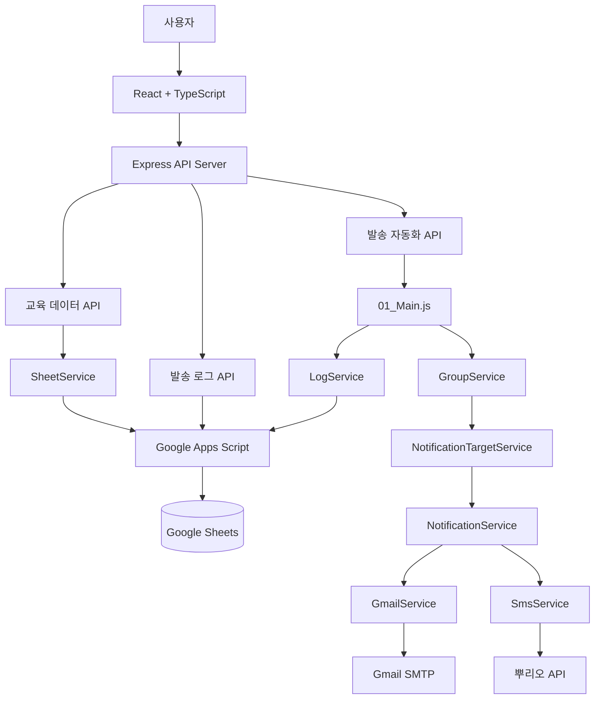

# 교육사업 운영 관리 및 문자·이메일 발송 자동화 시스템

Google Sheets 기반의 교육 운영 데이터를 웹 대시보드에서 통합 관리하고, 이메일·SMS 발송 업무를 자동화하는 웹 서비스.

교육 데이터 조회부터 사업별 운영 현황 확인, 발송 실행, 발송 이력 관리까지 하나의 시스템에서 처리할 수 있도록 개발함.


## 웹 서비스 미리보기

### 1. 교육 운영 대시보드

전체 교육 운영 현황과 사업별 통계를 확인하고, 발송 자동화를 실행할 수 있음.


### 2. 교육 데이터 조회

GW·DS 사업의 교육 데이터를 통합 조회하고, 사업 유형과 교육 기간에 따라 데이터를 필터링할 수 있음.


### 3. 사업 현황

사업별 교육 건수와 지역·권역별 운영 현황을 확인할 수 있음.


### 4. 발송 로그 관리

이메일 및 문자 발송 이력을 검색·정렬하고, 상세 정보를 확인할 수 있음.


---
## 주요 기능

| 기능 | 설명 |
|---|---|
| 교육 운영 대시보드 | 전체 교육 건수, 사업별 통계 및 교육 운영 추이 확인 |
| 교육 데이터 조회 | GW·DS 교육 데이터 통합 조회 및 기간별 필터링 |
| 사업 현황 | 지역·권역·수요처·학교별 교육 현황 집계 |
| 이메일·SMS 자동 발송 | 교육 일정과 대상자 정보를 기반으로 안내 메시지 발송 |
| 발송 로그 관리 | 발송 결과 저장, 검색, 정렬 및 상세 이력 조회 |
| 예약 발송 | 매일 오전 10시 기준으로 교육 안내 자동 실행 |

### 사업별 발송 방식

**GW**
- 강사별 교육 일정 그룹화
- Gmail SMTP를 통한 이메일 발송
- 뿌리오 API를 통한 SMS/LMS 발송

**DS**
- 학교, 과정, 담당교사, 주강사, 보조강사 기준으로 교육 일정 그룹화
- 담당교사·주강사·보조강사 역할별 SMS 발송
- 지정된 교육 과정의 대여 교구 확인 문자 발송

---
## 기술 스택

| 구분 | 기술 |
|---|---|
| Frontend | React 19, TypeScript 6, Vite 8 |
| Styling | CSS |
| Backend | Node.js, Express 5 |
| Email | Nodemailer, Gmail SMTP |
| SMS | 뿌리오 API |
| Database | Google Sheets |
| Integration | Google Apps Script |
| Scheduler | node-cron |
| Code Quality | ESLint |
| Version Control | Git, GitHub |

---
## 시스템 아키텍처

프론트엔드, API 서버, 자동화 모듈의 역할을 분리하고 Google Apps Script를 통해 Google Sheets와 연동하도록 구성함.



### 데이터 처리 흐름

**교육 데이터 조회**

1. 프론트엔드에서 사업 유형과 조회 기간 선택
2. Express API를 통해 교육 데이터 조회 요청
3. SheetService가 Google Apps Script를 통해 데이터 조회
4. DataMapper가 사업별 데이터를 공통 객체 구조로 변환
5. 조회 결과를 웹 화면의 목록·통계·차트로 표시

**이메일·문자 발송**

1. 웹 화면에서 발송 작업 실행
2. Express API에서 실행 조건과 중복 실행 여부 확인
3. `runDispatch()`를 통한 자동화 로직 실행
4. 교육 일정 그룹화 및 발송 대상 생성
5. 사업과 수신 대상에 맞는 이메일·문자 발송
6. 발송 결과를 Google Sheets에 일괄 저장
7. 프론트엔드에서 작업 상태와 발송 이력 확인

---
## 핵심 구현 내용

### 1. 사업별 데이터 구조 통합

GW와 DS는 교육 데이터의 컬럼과 운영 방식이 서로 다름.

사업별 데이터 처리 기준을 분리하고, DataMapper를 통해 프론트엔드에서 공통으로 사용할 수 있는 객체 구조로 변환함.

### 2. 발송 로직 모듈화

반복되는 발송 업무를 역할별 서비스로 분리함.

| 모듈 | 역할 |
|---|---|
| `SheetService` | Google Sheets 데이터 조회 |
| `GroupService` | GW·DS 교육 일정 그룹화 |
| `NotificationTargetService` | 발송 대상 및 수신 정보 생성 |
|` NotificationService` | 사업별 발송 채널 및 로직 분기 |
| `TemplateService` | 메시지 템플릿 생성 |
| `GmailService` | 이메일 발송 |
| `SmsService` | SMS/LMS 발송 |
| `LogService` | 발송 결과 생성 및 일괄 저장 |

### 3. 비동기 발송 및 중복 실행 방지

웹에서 발송 요청을 보낸 후에도 화면에서 작업 진행 상태를 확인할 수 있도록 구현함.

- 발송 작업별 고유 ID 생성
- `queued`, `running`, `succeeded`, `failed` 상태 관리
- 작업 실행 중 중복 요청 제한
- 작업 ID를 이용한 진행 상태 조회
- 발송 완료 후 처리 결과 반환

현재 작업 상태는 Express 서버 메모리에서 관리함. 따라서 서버가 재시작되면 기존 작업 상태는 유지되지 않음.

### 4. 예약 발송 스케줄러

`node-cron`을 이용해 매일 오전 10시 정기 발송이 실행되도록 구현함.

| 항목 | 설정 |
|---|---|
| 실행 주기 | 매일 오전 10시 |
| 시간대 | `Asia/Seoul` |
| Cron 표현식 | `0 10 * * *` |
| 발송 설정 조회 | `GET /api/dispatch/settings` |
| 발송 실행 | `POST /api/dispatch/run` |

기존 Express 발송 API를 재사용하여 발송 작업 ID 생성과 중복 실행 제한을 동일하게 적용함.

`DAYS_BEFORE` 설정에 따라 조회할 교육 기준일이 결정됨.

| (예) 설정값 | 조회 대상 |
|---|---|
| `0` | 당일 교육 |
| `1` | 다음 날 교육 |
| `7` | 7일 후 교육 |

스케줄러는 API 서버와 별도 프로세스로 실행되며, 예약 실행 시간에 서버가 종료되어 있으면 작업이 실행되지 않음. 놓친 예약을 자동으로 보충하는 기능은 현재 포함되어 있지 않음.

---
## 프로젝트 구조

```text
email_sms_auto
├── README.md
├── app.js                         # 예약 발송 스케줄러 진입점
│
└── google-sheet-reader
    ├── Frontend                    # (Frontend) React + TypeScript
    │   └── src
    │       ├── Components
    │       ├── Configs
    │       ├── CSS
    │       ├── Hooks
    │       ├── Pages
    │       ├── Services
    │       ├── Types
    │       └── Utils
    │
    ├── Routes                      # Express API 라우터
    │   ├── dispatchRoutes.js
    │   ├── educationRoutes.js
    │   └── logRoutes.js
    │
    ├── src                         # (Backend) 자동화 및 데이터 처리
    │   ├── Configs
    │   ├── Services
    │   │   ├── 00_Scheduler.js
    │   │   ├── GmailService.js
    │   │   ├── GroupService.js
    │   │   ├── LogService.js
    │   │   ├── NotificationService.js
    │   │   ├── NotificationTargetService.js
    │   │   ├── SheetService.js
    │   │   ├── SmsService.js
    │   │   └── TemplateService.js
    │   ├── Utils
    │   └── 01_Main.js
    │
    ├── server.js
    └── package.json
```

---
## 실행 방법

### 1. 실행 환경

- Node.js 18 이상
- npm
- Google Sheets 및 Google Apps Script 접근 권한
- Gmail SMTP 계정 및 앱 비밀번호
- 뿌리오 API 계정 및 인증 정보

### 2. 저장소 복제 및 패키지 설치

```bash
git clone <repository-url>
cd email_sms_auto/google-sheet-reader

npm install
```

프론트엔드 패키지도 별도로 설치.

```bash
cd Frontend
npm install
```

### 3. 환경변수 설정

백엔드의 `google-sheet-reader/.env` 파일을 생성.

```env
PORT=3000
FRONTEND_URL=http://localhost:5173

GW_APPS_SCRIPT_URL=
DS_APPS_SCRIPT_URL=
LOG_APPS_SCRIPT_URL=
LOG_API_TOKEN=

GMAIL_USER=
GMAIL_APP_PASSWORD=
```

프론트엔드의 `Frontend/.env.local` 파일을 생성.

```env
VITE_API_BASE_URL=http://localhost:3000
```

실제 발송 관련 인증 정보와 스프레드시트 ID 등은 프로젝트 루트의 비공개 `security_info.js`에서 관리.

### 4. 서버 실행

각 프로세스는 별도의 터미널에서 실행.

**① 백엔드 API 서버**

`google-sheet-reader` 디렉터리에서 실행.

```bash
npm run server
```

**② 프론트엔드 개발 서버**

`google-sheet-reader/Frontend` 디렉터리에서 실행.

```bash
npm run dev
```

**③ 예약 발송 스케줄러**

먼저 백엔드 디렉터리에서 패키지를 설치.

```bash
npm install node-cron@^3.0.3
```

`google-sheet-reader/package.json`의 scripts에 다음 항목을 추가.

```json
{
  "scheduler": "node ../app.js"
}
```

그다음 `google-sheet-reader` 디렉터리에서 실행.

```bash
npm run scheduler
```

예약 발송 스케줄러는 API 서버가 실행 중인 상태에서 동작해야 함.

### 5. 코드 검사 및 빌드

`Frontend` 디렉터리에서 실행.

```bash
npm run lint
npm run build
```

---
## 보안 및 운영 유의사항

다음과 같은 민감 정보는 GitHub 공개 저장소에 업로드하지 않음.

- `.env`, `.env.local`
- `security_info.js`
- Gmail 계정 및 앱 비밀번호
- 뿌리오 API 인증 정보
- Google Apps Script 인증 토큰
- Google Sheets 스프레드시트 ID 및 실제 교육 데이터
- 실제 수신자의 이름, 연락처, 이메일 주소

실제 발송을 활성화하기 전에는 `Config.js`의 테스트 모드와 수신자 설정을 반드시 확인해야 함.

현재 Express 서버에는 사용자 로그인 및 권한 확인 기능이 없음. CORS만으로 API 접근이 보호되는 것은 아니므로 외부 공개 배포 시 인증·인가와 네트워크 접근 제한을 추가해야 함.

---
## 향후 개선 계획

- 사용자 인증 및 역할별 접근 권한 관리
- 발송 작업 상태의 영구 저장
- 발송 실패 건 재처리 및 재발송 기능
- Google Sheets 데이터 유효성 및 누락 데이터 점검 자동화
- API 및 자동화 실행 모니터링 강화
- 배포 환경에 맞춘 비밀 정보 관리 체계 개선

---
## 상세 기술 문서

- [API 명세](docs/API.md)
- [설치 및 실행 가이드](docs/SETUP.md)
- [프로젝트 구조](docs/STRUCTURE.md)
---